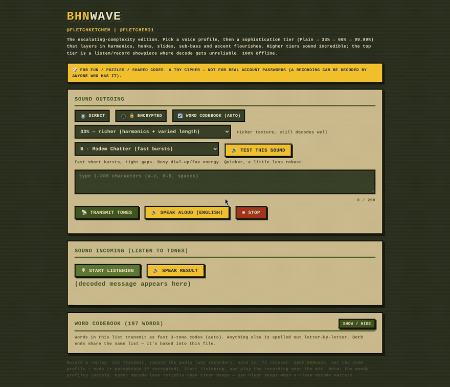
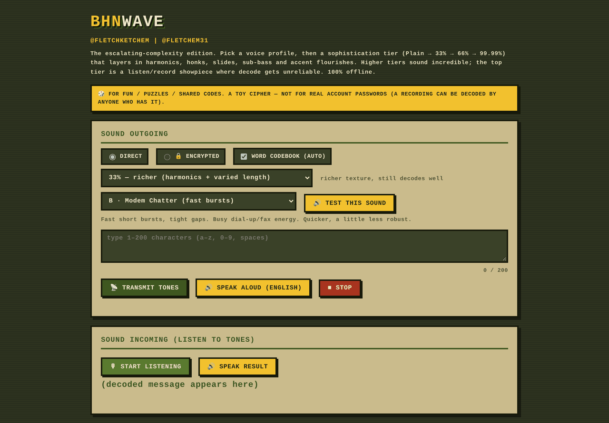
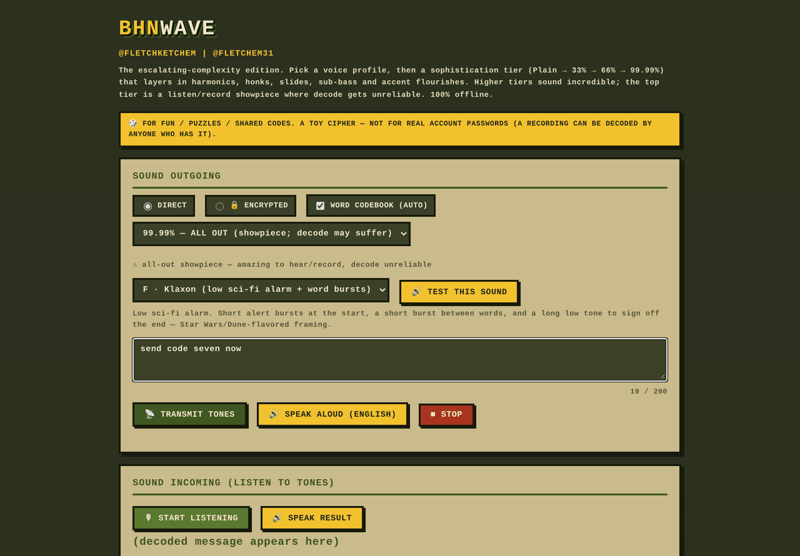
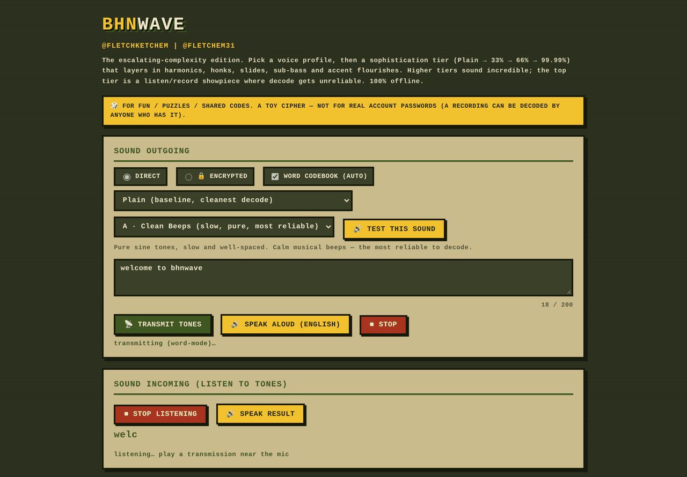
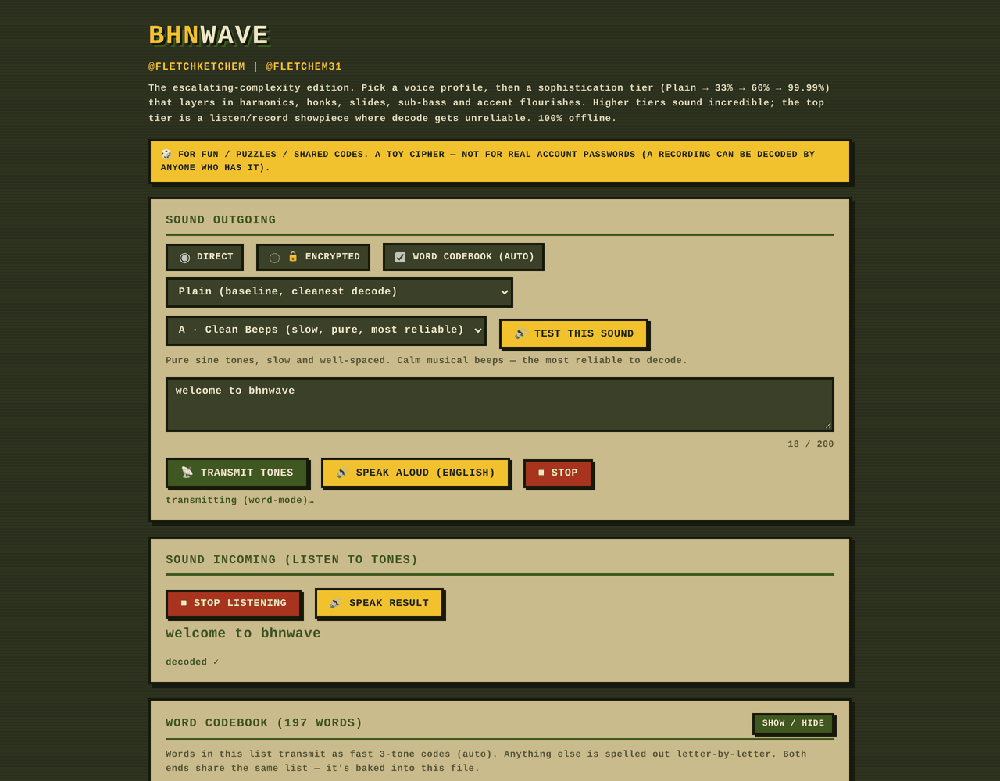

# BHNwave

A fully-offline, beep-tone cipher language. One self-contained HTML file per app — no
dependencies, no internet, no tokens, no cost. Type a message → encode it as tones →
transmit / record / share → decode it back to text → optionally speak it aloud.

> 🎲 **For fun / puzzles / shared codes.** A toy cipher — not for real account passwords.
> A recording can be decoded by anyone who has it (plus the passphrase, in encrypted mode).

  

  <b><a href="https://raw.githack.com/FletchEm31/BHNwave/main/BHNwave-Sophisticated.html">▶ Try it in your browser</a></b>
  &nbsp;·&nbsp; <a href="docs/media/demo_30s.gif">30-second walkthrough (GIF)</a>

> [!IMPORTANT]
> **Not for sale.** BHNwave is a personal passion project — built as a hands-on way to grow my coding skills while exploring audio signal processing and browser cryptography. It's a learning and portfolio project, not a commercial product, and it is not for sale or licensing.

---

## See It In Action

**Pick a voice.** Six sound profiles and four sophistication tiers, from clean sine beeps to a full sci-fi klaxon.

**Transmit and listen.** Every character becomes its own tone (520–3760 Hz, 90 Hz apart). The listener reads the tones back through the microphone with an FFT.

**Decoded.** The message comes back as text — fully offline, nothing leaves the device.

---

## What's in here

| File | What it is |
|------|-----------|
| `BHNwave.html` | The reliable workhorse. 5 sound profiles, Direct + 🔒 Encrypted modes. |
| `BHNwave-Sophisticated.html` | Adds sophistication tiers (Plain / 33% / 66% / 99.99%), the Klaxon alarm profile, and the 197-word auto-mixed word codebook. **Official voice defaults baked in.** |
| `BHNwave-SPEC.md` | The official spec — full character alphabet, all 197 codebook words, frequencies, and how encryption works. |
| `COMMUNITY-DEMO.md` | Try-it pack: public demo passphrases, demo messages, and a step-by-step walkthrough for both modes. |
| `secret-generator.html` | Offline passphrase/secret generator (browser CSPRNG). |
| `Generate-Secret.ps1` | Same idea as a PowerShell script (.NET CSPRNG). |

---

## How to use it
1. Download the repo (or just the HTML file you want).
2. Double-click `BHNwave-Sophisticated.html` — it opens in your browser and runs **100% offline**.
3. Type a message, hit **Transmit tones**. To decode, hit **Start listening** and play the tones near the mic.
4. For encrypted messages, both sender and receiver set the same passphrase.

No install, no build, no server. The HTML file *is* the program.

---

## Official voice
- **Profile:** B · Modem Chatter (fast bursts)
- **Sophistication:** 33% (harmonics + varied length)
- **Word codebook:** Auto (on)

These are the defaults `BHNwave-Sophisticated.html` opens with.

---

## How it works (short version)
- **Each character** (space, a–z, 0–9) = one frequency tone (520–3760 Hz, 90 Hz apart).
- **Common words** (197 of them) transmit as compact 3-tone codes; off-list words are spelled out. Auto-detected per word.
- **Encrypted mode** uses real AES-GCM (PBKDF2 key from your passphrase) via the browser's Web Crypto — runs locally, nothing leaves the machine.
- **Decoding** reads tones back via an FFT on the mic input.

Full details — including the complete word list and frequency map — are in `BHNwave-SPEC.md`.

---

## Honest limitations
- **Not ggwave.** ggwave is an engineered DSP protocol with error correction and multi-tone encoding that survives real-world noise. BHNwave is a homemade single-tone-per-symbol scheme with **no error correction** — it decodes well in clean conditions with a good mic, but it's a fun cousin of ggwave, not a robust replacement.
- **Decode reliability varies by profile.** Clean Beeps + Plain is most reliable. Moody profiles (Dune, Klaxon) + high sophistication + word-mode are the least reliable — great for listening, weaker for clean decode.
- **Encryption is real but the use is a toy.** Playing encrypted tones aloud broadcasts ciphertext into the open, where it could be recorded and attacked offline. Fine for puzzles and fun; never for credentials that protect something real.
- **No voice input.** It speaks English *out* (offline TTS) and decodes *tones* in, but it does not transcribe your spoken voice (that would need cloud speech-to-text and break the offline design).

---

## License
Personal / private project. All rights reserved unless you decide otherwise.
